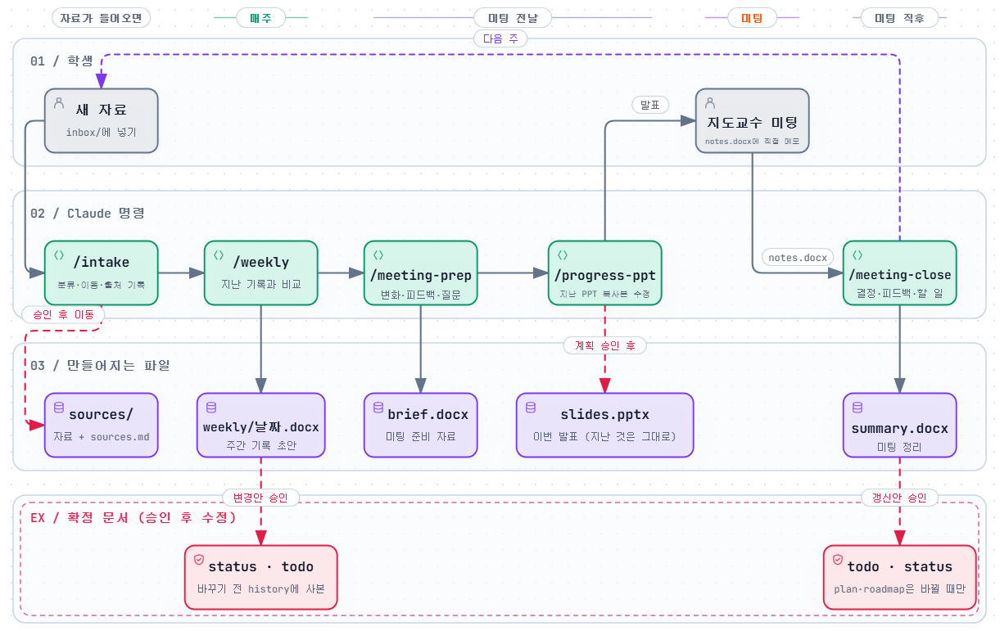
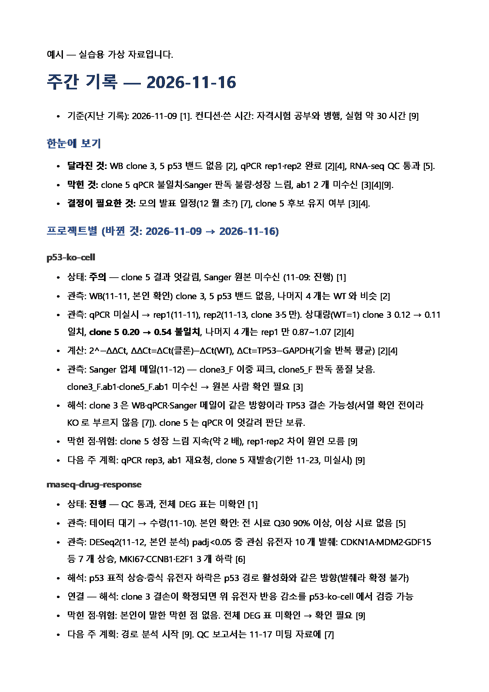
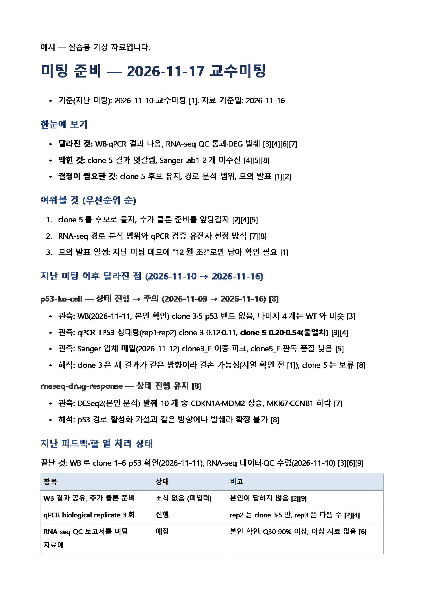
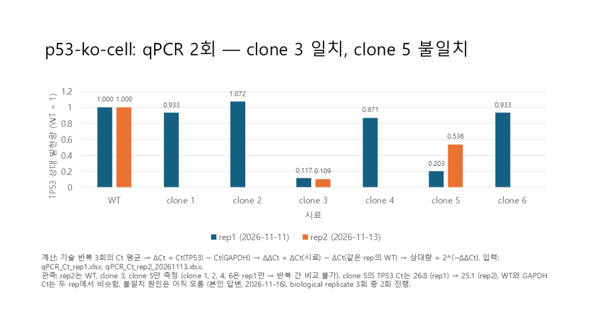
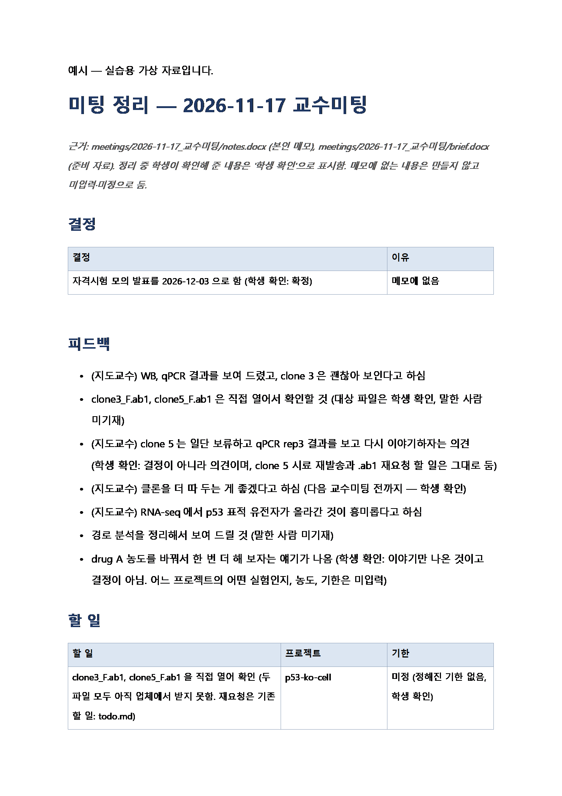

# Claude Code 연구 관리 워크스페이스

대학원생이 자기 연구의 **자료 정리, 주간 기록, 지도교수 미팅, 발표자료**를 Claude Code로 관리해 보는 수업용 워크스페이스입니다. 전공과 상관없이 쓸 수 있게 만들었고, 안에 들어 있는 연구 자료는 모두 **가상**입니다(예시는 가상의 생명과학 실험).

> Claude는 정리와 초안을 만들고, 확정은 내가 한다.

## 이 저장소에 있는 것

| 폴더 | 내용 |
|---|---|
| [`practice-start/`](practice-start) | **실습 출발점.** 가상 연구 3주차가 시작된 때의 워크스페이스입니다. 통째로 복사해서 씁니다 |
| [`examples/`](examples) | 명령을 실행했을 때 나오는 결과물 예시(Word, PPT)와 미리보기 그림 |
| [`docs/`](docs) | 도식 |

## 빠른 시작

1. 이 저장소를 받습니다. **Code → Download ZIP**을 누르거나, `git clone https://github.com/yopi0214/meeting_class.git`을 실행합니다.
2. `practice-start` 폴더를 통째로 복사해 새 이름(예: `my-practice`)으로 둡니다. 원본은 다시 실습할 수 있게 그대로 둡니다.
3. 복사한 폴더를 Claude Code로 엽니다.
4. 폴더 안 `README.md`의 실습 순서대로 명령을 입력합니다. 단계마다 폴더를 열어 무엇이 바뀌었는지 확인합니다.

## 필요한 것

- **Claude Code**
- **Windows 10/11** (PowerShell 5.1). `practice-start/tools/`의 스크립트가 Word, Excel, PPT를 읽고 씁니다. 따로 설치할 것은 없습니다.
- **Word · Excel · PowerPoint.** PPT를 만드는 `/progress-ppt`는 PowerPoint가 필요하고, 문서 쪽수 확인도 Word가 있을 때만 됩니다.
- **Mac 등 다른 환경:** `tools/` 스크립트가 Windows용이라 직접 설정해야 합니다. 설치된 Word·Excel·PPT용 스킬이나 python-docx, openpyxl, python-pptx로 같은 일을 하도록 `practice-start/CLAUDE.md`의 "Office 파일 다루기"를 고쳐 쓰세요.

## 명령 6개

| 명령 | 언제 | 결과 |
|---|---|---|
| `/intake` | 새 자료를 `inbox/`에 넣은 뒤 | 자료를 읽어 프로젝트·날짜별로 이동하고 출처를 기록 |
| `/weekly 날짜` | 매주 한 번 | 지난 기록과 비교한 주간 기록(Word, 2쪽 이내) |
| `/meeting-prep 종류 날짜` | 미팅 전날 | 질문이 앞에 나온 미팅 준비 자료(Word, 2쪽 이내) |
| `/progress-ppt 종류 날짜` | 발표 전날 | 지난 발표 PPT를 복사해 새 결과만 고친 이번 PPT |
| `/meeting-close 폴더` | 미팅 직후 | 내 메모(Word)를 결정·피드백·할 일로 정리(Word) |
| `/paper-note 논문` | 논문을 읽을 때 | 읽기 노트(Word), 내 연구와의 연결 |

## Claude가 지키는 규칙 5가지

1. **원본은 고치지 않는다.** 필요하면 새 파일을 만든다.
2. **모든 결과에 근거를 붙인다.** 어느 파일에서 왔는지, 언제에서 언제까지의 변화인지 적는다.
3. **지어내지 않는다.** 파일에 없으면 `미입력`, 근거가 약하면 `확인 필요`로 표시한다.
4. **관측과 해석을 나눈다.** 해석은 `해석:`으로 시작한다.
5. **확정 문서는 내가 승인한 것만 고친다.** 바꿀 내용을 먼저 보여 주고, 승인하면 고치기 전 사본을 남긴다.

이 규칙은 `practice-start/CLAUDE.md` 한 파일에 적혀 있고, 내 연구에 맞게 고칠 수 있습니다.

## 결과물 예시

가상 자료로 명령을 실행한 결과입니다. 파일은 [`examples/`](examples)에 있습니다.

| `/weekly` — 주간 기록 (Word) | `/meeting-prep` — 미팅 준비 (Word) |
|---|---|
|  |  |

| `/progress-ppt` — 진도점검 PPT | `/meeting-close` — 미팅 정리 (Word) |
|---|---|
|  |  |

## 알아 둘 점

- Claude는 **그림·사진·차트의 내용을 읽지 못합니다.** 내용을 아는 사람이 적어 줘야 합니다(`사람 확인 필요`로 표시됩니다).
- **한글(.hwp)과 CAD 같은 형식은 읽지 못합니다.** Word, PDF, 텍스트로 내보내서 넣으세요.
- **만든 Word·PPT는 반드시 직접 열어 확인하세요.** 숫자, 날짜, 문장이 근거와 맞는지 봅니다.
- 내 연구 자료를 넣기 전에 **미공개·민감 자료**에 대한 연구실·학교 정책을 확인하세요. Claude가 파일 내용을 읽습니다.
- 명령 하나에 Claude가 일하는 시간은 몇 분입니다(시연 기준 대략 3~7분).
